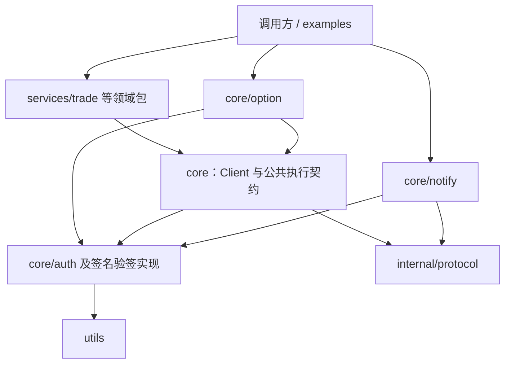
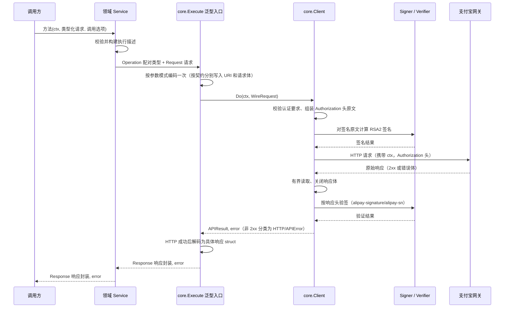

# 整体架构

状态：SDK 首版尚未发布，仅支持支付宝 V3。`core.Client` 执行 V3 REST；页面/唤端产物与普通支付通知按各自契约处理。沙箱验收尚未执行。接口证据见[接口版本说明](api-versions.md)，后续工作见[开发计划](development-plan.md)。

## 1. 目标与边界

构建一个可复用、可测试的支付宝第三方 Go SDK，采用 `core.Client` 与领域 API Service 分离的结构。调用方既能使用类型化 Service，也能通过 Client 调用尚未封装的接口，并复用相同的协议、安全和错误处理能力。

**SDK 仅支持支付宝 V3**：服务端接口统一使用官方 V3 REST 路由；页面支付、手机网站支付和 App 订单串按各自官方 V3 文档与产物构建规范提供本地签名产物（不发 HTTP）；普通支付异步通知按通知自身契约解析与验签。共享配置、日志与类型化流程，REST 执行、本地签名产物构建和通知处理三者边界独立。

SDK 不负责商户订单持久化、分布式锁、业务幂等记录、补单任务、对账调度或资金状态机，也不强制依赖 Web 框架、数据库、缓存与日志框架。页面跳转和 App 唤端能力由 `core.NewArtifactBuilder` 提供本地签名产物构建（不发送网络请求）。

## 2. 已作出的设计选择

| 主题 | 本方案选择 | 理由或边界 |
| --- | --- | --- |
| 工程结构 | 单 Go module，`core/`、`services/`、`utils/` 分层 | 项目、文档与示例统一使用 alipay 命名 |
| Go 版本 | `go 1.24.0` 及以上 | 新版能力由编译标签隔离 |
| 协议范围 | 仅 V3 REST；页面/唤端产物与通知按各自契约保留 | 单一协议路径，无协议协商与跨协议回退 |
| 调用方式 | REST、页面跳转、App 签名数据分别建模 | 文档版本不代替调用方式；页面产物不在 REST 清单内 |
| 初始化 | `core.NewClient` 配合 `core/option`；Service 通过构造函数注入 | 配置校验集中，Service 易于替换执行器进行测试 |
| 配置作用域 | Client 级静态配置与请求级选项分开 | 同一 Client 并发调用时，不发生商家令牌与回调地址串用 |
| 数据模型 | 已知数据使用具名 struct，嵌套对象使用具体类型 | 动态键值仅用于协议边界；枚举使用具名类型与带类型常量 |
| 泛型 | 泛型 Client 方法、`Operation[Req, Resp]`、`Request[T]`、`Response[T]` 与编解码器 | 请求与响应在编译期配对，新增接口不修改传输层 |
| 自定义 API | 用户在独立包实现模型、Operation 与 Service | 扩展仅依赖公开包，不要求 SDK 预注册接口名 |
| JSON | 标准库 JSON 编解码，公开原始节点使用 `json.RawMessage` | 严格校验并保留签名原文，明确空值与字段省略策略 |
| 返回值 | `*Response[T]` 与 error；响应包含类型化数据及调用元信息 | 业务模型与网络诊断分开；本地构建类方法采用对应产物类型 |
| 金额 | 首期采用十进制字符串 | 不引入浮点误差，序列化格式按目标 API 文档确定 |
| 重试 | 默认不自动重试 | 写操作超时不能说明操作未执行 |
| 日志 | 标准库 `log/slog`，注入 Logger 或任意 Handler 实现 | 后端由调用方选择，默认静默，结构化字段经过筛选 |
| 证书更新 | 首期本地可信证书集合；更新后重建 Client | 不引入后台协程、全局下载器或未验证的远端信任 |
| 代码生成 | 首期手写协议核心与代表性 Service | 先验证模型和执行契约，后续再评估稳定的生成来源 |

协议语义依据官方 V3 OpenAPI 快照与[接口版本说明](api-versions.md)中的官方文档；页面/唤端产物按官方 V3 文档规定的 `gateway.do` 格式本地构建。

### 2.1 Go 版本与编译选择

模块最低版本为 `go 1.24.0`。所有工具链均可使用相同的 Service、包级泛型函数和 `json.RawMessage` 公开接口。版本差异在编译时选择，默认构建只依赖标准库。

| 能力 | 编译时选择 |
| --- | --- |
| 请求与通知 | 各版本复用包级执行流程。Go 1.27 起额外提供 Client 和 Handler 的泛型方法。 |
| 响应与沙箱请求解码 | Go 1.27 起默认使用标准库 JSON v2。旧工具链使用 `encoding/json` 并校验重复成员、UTF-8 和字段名。沙箱请求还会拒绝未知字段。签名输入始终保留原文。 |
| URL 与表单拷贝 | Go 1.27 起调用标准库 Clone，旧版逐项复制 URL 和表单切片。 |
| 错误匹配 | Go 1.26 起用 `errors.AsType`，旧版用 `errors.As` 遍历同一错误链。 |
| 虚拟时间测试 | Go 1.25 起运行 `testing/synctest` 用例，通用取消、HTTP 和验签测试在所有版本运行。 |

CI 固定各已支持系列并跟踪最新稳定 Go，使用 `GOTOOLCHAIN=local` 验证所选工具链。[Go 1.27 发布说明](https://go.dev/doc/go1.27)

## 3. 目录规划

下列目录按实际功能创建，不提前生成空包。`trade`、`fund` 等为领域划分，各自按独立业务拆为子包；专属模型随接口放置，共享模型保留在共同父包。完整路径与文件增长约定见[业务包目录](service-layout.md)。

```text
alipay-sdk-go/
├── go.mod
├── README.md
├── core/
│   ├── client.go                # V3 REST 执行、HTTP 生命周期
│   ├── artifact.go              # 页面/唤端签名产物构建（不发 HTTP）
│   ├── settings.go              # Client 配置、网关与环境、ClientOption 契约
│   ├── errors.go                # 可识别错误及原因链
│   ├── type.go                  # 泛型 Request/Response/Operation 与规格、编解码
│   ├── logger.go                # slog 注入、固定日志字段与安全输出
│   ├── option/                  # 配置选项组装
│   ├── auth/
│   │   ├── credentials.go       # Credentials、CertificateProvider 等契约
│   │   ├── public_key.go        # 公钥凭证
│   │   ├── certificate.go       # 证书凭证
│   │   ├── identity.go          # 证书身份标识
│   │   ├── resolver.go          # 本地可信证书索引与按 SN 选择
│   │   ├── signers/             # RSA2 签名实现
│   │   └── verifiers/           # RSA2 验签与可信密钥选择
│   └── notify/                  # 通知解析、验签；不含商户订单逻辑
├── services/
│   ├── trade/                   # 交易 REST、页面/App 产物与通知模型
│   ├── fund/                    # 资金共享模型
│   │   ├── trans/               # 转账、支付、退回与查询
│   │   ├── accountbook/         # 记账本
│   │   └── jointaccount/        # 共同账户；其余子域见业务包目录
│   ├── data/
│   │   ├── bill/                # 账单查询与电子回单
│   │   └── dataservice/ad/      # 广告数据服务
│   ├── open/                    # 应用授权令牌
│   └── system/                  # 用户授权令牌
├── utils/                       # 独立的密钥与证书解析工具（SN 规则在 internal/protocol）
├── internal/
│   ├── protocol/                # V3 协议原文、签名参数、证书 SN 等底层实现
│   └── testutil/                # 专用测试材料与协议断言
├── examples/                    # 可独立运行的场景示例
├── cmd/                         # 有实际需求后增加命令行工具
└── docs/
    ├── README.md
    ├── architecture.md
    └── development-plan.md
```

业务包的接口实现统一放在 `api_[package_name].go`，请求与响应分别放在 `[package_name]_request.go`、`[package_name]_response.go`，枚举、通知及共享或嵌套模型放在 `[package_name]_model.go`。其中 `[package_name]` 使用 Go 的实际包名，例如交易包使用 `api_trade.go`、`trade_request.go`、`trade_response.go` 与 `trade_model.go`；`services/open/public/default` 的包名为 `defaultapi`，对应文件以 `defaultapi` 命名。包说明继续放在 `doc.go`，测试与可编译示例分别使用 `*_test.go`、`*_example_test.go`。

请求结构体和请求类型以 `Request` 结尾，响应结构体和响应类型以 `Response` 结尾；公共、共享及嵌套结构体不使用 `Model` 后缀。类型名与官方 schema 名可以不同，字段名和协议标签仍保持官方契约。

生成类型直接使用业务名称，不附加 `Generated`、`Model` 或重复的命名域前缀，也不通过额外别名暴露同一个请求或响应。例如 `services/zhima/credit` 直接定义 `PayAfterUseCreditAgreementTransferRequest`，`services/open/mini/innerapp` 直接定义 `MiniInnerAppPluginOrderResponse`。

单元测试放在被测实现附近。展示调用方式的示例使用领域包的 `api_[package_name]_example_test.go`，保留独立的 `xxx_test` 包，不添加忽略构建的标记。`go test` 与 `go vet` 会检查示例编译；没有 `Output` 注释的示例仅编译，不自动执行。默认测试保持离线，真实沙箱调用必须显式启用，证书配置与运行命令见[沙箱验收指引](sandbox-verification.md)。例如，仅检查交易包的编译：

```sh
go test ./services/trade -run '^$'
```

仅需要启动 HTTP 服务等独立运行场景才放入 `examples/`。

## 4. 包依赖与职责

下图箭头表示允许的导入方向，不表示运行时数据流。



- `core` 不导入 `services`、`core/option` 或 `core/notify`。
- `core/option` 负责将密钥、证书和选项组装为 `core` 定义的配置，不能把基础 Client 绑定到业务包。
- `core/auth` 与底层实现不反向导入 Client；共享的签名契约放在基础包中。
- `core/notify` 接收通用参数或目标模型，不依赖 `services/trade` 的通知结构。
- `utils` 仅提供独立工具，不依赖 `core` 或 `services`。内部专用实现保留在 `internal/`。
- 公共 Service 容器如存在，只保存执行器，不导入领域子包。暂不提供自动注册全部业务 Service 的聚合对象。

### 4.1 Client 与本地能力

core 层的公开能力分三块，边界独立：

1. **V3 REST 执行**（`core.Client`）：统一处理公共身份与签名头、编码、HTTP 执行、响应头验签、错误体解析和通用错误分类。Client 处理协议层的错误码，但不解释商户订单状态，也不包含退款金额等业务字段。
2. **页面/唤端产物构建**（`core.NewArtifactBuilder`）：按官方页面与唤端产物契约组装传统网关签名参数并计算签名，产出 URL、HTML Form 或订单串；不发 HTTP 请求，使用独立的产物网关配置。
3. **异步通知**（`core/notify`）：独立表单解码、按通知类型构建验签原文并验签；与 REST 响应头验签互不复用。

Client 初始化完成后配置保持稳定，网络连接可复用。请求执行不修改调用方对象；每次调用复制参数并生成独立的时间戳与签名。不运行自动刷新任务，避免额外的启动、关闭与协程所有权问题。

### 4.2 Service

领域 Service 定义官方接口名、HTTP 方法与路由、类型化请求/响应和确定的本地校验，通过 `Operation[Req, Resp]` 固定模型配对，再委托通用泛型流程与 Client 执行。明确的必填关系可以本地校验，权限、产品开通状态等动态条件由平台裁决。

Service 内的交易状态和退款状态保持官方语义；查询请求处理成功，不等于支付成功。V3 REST 的成功语义由 HTTP 状态决定：查询接口 HTTP 成功只表示查询本身完成，支付结果必须以 `trade_status` 等业务字段为准；处理中、待确认等接口特定状态由 Service 的响应模型与 GoDoc 如实暴露，不在全局增加宽松的成功判定。

## 5. 公开 API 形态

以下展示已实现的调用形态；具体字段以代码与 GoDoc 为准。`any` 仅出现在泛型类型参数约束中，实际业务数据始终是具体 struct。

```go
// core 包：配置构建不进行网络 I/O，因此构造函数不要求 context。
// core.Client 是唯一 REST 客户端，执行 V3 REST 协议。
// core.NewArtifactBuilder 构建页面/唤端签名产物（不发 HTTP 请求）。
func NewClient(credentials auth.Credentials, opts ...ClientOption) (*Client, error)

// 传输层使用确定的协议类型，不接收无类型业务输出参数。
type Executor interface {
	Do(ctx context.Context, req WireRequest) (*APIResult, error)
}

type Request[T any] struct {
	Body    T
	Options CallSettings
}

type Response[T any] struct {
	Data   *T
	Result *APIResult
}

// 字段不导出；由具名构造函数校验并建立接口与编解码器的绑定。
type Operation[Req, Resp any] struct {
	spec    OperationSpec
	encoder Encoder[Req]
	decoder Decoder[Resp]
}

// 默认编解码入口：GET 自动 query、POST 自动 JSON body，
// spec.ParameterMode 零值时按 HTTPMethod 推断。
func NewJSONOperation[Req, Resp any](spec OperationSpec) (Operation[Req, Resp], error)

// 自定义编解码器入口，允许外部包实现接口，构造函数校验配置一致性。
func NewOperation[Req, Resp any](spec OperationSpec,
	encoder Encoder[Req], decoder Decoder[Resp]) (Operation[Req, Resp], error)

// 包级泛型入口：响应类型从 operation 推导，调用方不能任意替换。
func Execute[Req, Resp any](ctx context.Context, executor Executor,
	operation Operation[Req, Resp], req Request[Req]) (*Response[Resp], error)

// Go 1.27 泛型方法：仅委托共享 Execute，不另行实现协议流程。
func (c *Client) Execute[Req, Resp any](ctx context.Context,
	operation Operation[Req, Resp], req Request[Req]) (*Response[Resp], error) {
	return Execute(ctx, c, operation, req)
}

// services/trade 包：同一执行器可注入多个领域 Service。
func NewService(executor core.Executor) (*Service, error)
func (s *Service) Query(ctx context.Context, req QueryRequest,
	opts ...core.CallOption) (*core.Response[QueryResponse], error)
```

通用调用链为 `具体请求 struct -> Request[Req] + Operation[Req, Resp] -> Execute -> Executor.Do -> Response[Resp]`。领域 Service 使用包内固定 Operation，调用方扩展未封装接口时自行定义请求/响应 struct，并显式构造相应 Operation。

Go 1.27 已支持方法独立声明类型参数，因此提供 `Client.Execute[Req, Resp]` 作为直接调用入口；它仅委托共享的包级 `core.Execute`。领域 Service 通过非泛型 `Executor.Do` 注入执行器并使用相同共享流程，既能测试替身替换，也不重复协议逻辑。接口方法不能声明类型参数，不能将泛型 Execute 放进 Executor 接口。语法依据 [Go 方法声明规范](https://go.dev/ref/spec#Method_declarations)。

### 5.1 数据结构与扩展边界

| 对象 | 内容 | 限制 |
| --- | --- | --- |
| Client 配置 | APPID、环境、网关、Signer/Verifier、HTTP 执行器、超时与响应大小限制、`Logger *slog.Logger` | 不保存调用级商家令牌；公钥与证书模式明确区分 |
| `Operation[Req, Resp]` | 接口描述、请求编码器与响应解码器 | 固定请求/响应类型；零值或无效描述在发请求前失败 |
| `OperationSpec` | `Method`（官方方法名）、`HTTPMethod`、`Path`（`/v3/...` 相对路由）、`ParameterMode`、`AuthRequirement` | 具名 struct；参数模式与认证要求均为具名枚举，零值或无效组合在构造时失败 |
| `Request[T]` | 具体业务 struct 与本次调用配置 | 不包含动态业务容器，不承载签名与公共身份覆盖值 |
| `CallSettings` / `CallOption` | 当前请求的代调用令牌与产物路径的 notify_url | 选项构建明确的配置 struct，仅作用于当前调用；REST 路径拒绝此选项，有通知字段的接口使用请求模型的 NotifyURL |
| `Encoder[T]` / `Decoder[T]` | 具体类型与协议数据之间的转换 | 新增编解码策略不改变网络、安全与错误处理流程 |
| `EncodedParams` | 参数模式及相应的 query、JSON、multipart 业务数据 | 具名 struct；模式决定有效字段，拒绝冲突输入 |
| `WireRequest` | 接口描述、已编码参数、本次调用配置 | 只处理协议数据；不接收动态业务对象 |
| `Response[T]` | `Data *T` 与 `Result *APIResult` | 所有领域统一使用相同结果封装，失败时不填充可信业务数据 |
| `notify.Notification[T]` | 类型化通知数据与验证元信息 | 泛型解析入口完成验签后才构造业务数据 |

业务请求、响应、配置、错误、通知及嵌套对象采用具名 struct，已知字段不得退化为 `map[string]any`、裸 `any` 或 `interface{}`。泛型约束不改变这一要求：`T` 对应真实业务模型，而非动态字典。

`EncodedParams` 支持 query、JSON、query 与 JSON 组合，以及 multipart。JSON 正文使用 `json.RawMessage` 保存签名与传输共用的原文，query 使用 `url.Values`，HTTP 头使用 `http.Header`。动态键名确有需求时保留明确值类型，未知 JSON 片段保留为 `json.RawMessage`，不先解成无类型字典。参数位置必须依据对应接口的官方契约。

类型化 query 请求也由 struct 定义，通过 `query` 标签或显式编码器生成协议参数；不能要求调用方自行创建动态业务参数表。扩展能力通过新的 struct、Operation 或编解码器接入，不需要向 Client 添加业务分支。

可选字段优先使用具体类型指针。确需表达未传、null、零值三态时再引入 `Optional[T]`，并由配套编码器处理字段省略，不能假设 struct 配合 `omitempty` 自动获得三态语义。

### 5.2 枚举类型

枚举采用具名类型定义，配合显式带类型常量；例如交易状态：

```go
type TradeStatus string

const (
	TradeStatusWaitBuyerPay TradeStatus = "WAIT_BUYER_PAY"
	TradeStatusClosed       TradeStatus = "TRADE_CLOSED"
	TradeStatusSuccess      TradeStatus = "TRADE_SUCCESS"
	TradeStatusFinished     TradeStatus = "TRADE_FINISHED"
)
```

上述值依据[交易查询文档](https://opendocs.alipay.com/open/02ekfq.md)。模型中对应字段使用 `TradeStatus`，而不是 `string`。支付方式、退款状态、认证模式、环境、参数模式等同样建立各自的具名类型，避免不同领域的枚举相互混用。

- 使用 `type X string` 或 `type X uint8` 等类型定义；不使用 `type X = string` 这种不能形成独立类型边界的别名声明。
- 协议枚举写明官方值，不用 `iota` 自动推导；纯内部枚举可使用 `iota`。枚举所属业务包负责导出命名和值。
- 不把所有状态都归为同一个通用 `Status` 类型，也不把未知值转换成某个已知状态。
- 请求值按目标接口允许范围校验；响应保留未识别的原始值，调用方应能在 `switch` 的默认分支识别新值。可以提供 `IsKnown` 等辅助方法，不因新增响应枚举值自动拒绝整份响应。
- 测试验证精确的协议值、序列化结果、未知值保留，以及不同枚举类型之间的类型边界。

### 5.3 结果与失败语义

`APIResult` 保存 HTTP 状态、必要响应头（含 `alipay-sn` 等验签输入）、官方提供时的请求标识，以及签名验证状态。原始报文属于敏感诊断数据，若开放访问，应明确其敏感性与生命周期，不自动打印，也不混入错误字符串。Client 负责读取并关闭响应体；元信息不承诺响应体仍可读取。

失败时的约定：

- 构造失败不发送请求；参数或签名失败时可能没有 HTTP 元信息。
- 收到响应后即使执行失败，也可返回已经获得的元信息。
- 验签、解密或解析失败时，`Response[T].Data` 为 nil；已获得元信息时仍可返回结果封装，失败原因通过 error 表达，调用方先检查 error 再访问 Data。
- 业务失败保留 V3 错误体原文（`core.ErrorCode`）；本地错误通过原因链提供诊断，不依赖调用方匹配字符串。

### 5.4 用户自定义接口

未内置 API 的扩展属于首期公共契约，随 P1/P2 落地。用户在自己的包中定义请求/响应 struct、具名枚举与 Operation，直接调用 `Client.Execute` 或封装自己的 Service。无需修改 SDK 源码、导入内部包或注册全局接口表。

- 通常的 JSON 业务参数使用 `NewJSONOperation[Req, Resp]`：按 Operation 声明的位置编码 query 和 JSON，multipart 请求使用同一入口。
- 直接参数或特殊字段格式使用 `NewOperation[Req, Resp]`，由用户实现公开的 `Encoder[Req]` / `Decoder[Resp]`。
- 编解码接口与协议输入/输出类型全部公开，不包含私有方法，避免名义上可扩展但外部包无法实现。
- Client 不以已封装方法清单限制调用；方法描述、编码方式与响应规则需要校验，认证权限仍由支付宝决定。
- 用户负责接口文档、业务模型和校验；SDK 统一执行公共参数、签名、验签、证书、HTTP、slog 与错误处理，自定义解码器仅接收通过验证和必要解密的业务数据。
- 扩展不提供跳过安全流程的回调，也不能覆盖 APPID、签名或证书参数。尚未核验 V3 契约的接口必须明确报为未支持，不虚构路由。

公开构造与使用示例见[自定义接口扩展](custom-apis.md)。扩展机制必须通过外部测试包验证，不以 SDK 内部测试替代用户实际导入场景。

## 6. V3 REST 调用流程

以下为 V3 REST 执行流程；签名头、验签原文与错误体规则的协议依据见[协议说明](protocol-notes.md)。



实现重点：

1. 同一份序列化结果同时用于签名原文与传输，不在签名后重新编码业务数据。
2. 根据接口契约将参数写入 URI 或请求体，无请求体的操作发送空正文。Authorization 头签名原文包含 HTTP 方法、请求 URI 与请求体（规则见协议说明）。
3. 代调用令牌经 `alipay-app-auth-token` 头传递并参与签名；`alipay-request-id` 等不参与签名的头不进入原文。
4. 成功（2xx）响应缺 `alipay-signature` 头视为协议错误；验签失败或缺签不得作为可信结果返回。
5. 非 2xx 错误体 `{code, message, links}` 解析为 `*core.APIError`；携带签名时先验签，未带签名按未验签诊断处理（`Verified=false`）。

## 7. 本地支付产物与通知

### 7.1 页面与 App 支付

已通过 `core.NewArtifactBuilder` 与 `services/trade.PaymentProducts` 实现（2026-11-05）：构建入口复用公共参数与签名能力，不调用服务端 HTTP 执行入口；提供 PagePay/WapPay 的 URL 与 HTML Form、AppPay 的订单串三类产物。

接入依据为官方 V3 [page.pay](https://opendocs.alipay.com/open-v3/2423fad5_alipay.trade.page.pay)、[wap.pay](https://opendocs.alipay.com/open-v3/1a957be0_alipay.trade.wap.pay)、[app.pay](https://opendocs.alipay.com/open-v3/429e4d75_alipay.trade.app.pay) 及 V3 SDK `GenericExecuteApi`。页面接口明确返回 `pageRedirectionData`，App 返回 `orderStr`；产物契约不在 REST 清单内，不虚构 `/v3/...` 路由。

同一 `app.pay` 的[商家扣款 V3 场景](https://opendocs.alipay.com/open-v3/0jf33m)还包含支付并签约参数。接口名复用不表示模型和必填关系完全一致：按场景核验字段，用具名嵌套 struct 与枚举建模签约参数，避免将某一产品场景的限制套用到全部 App 支付。

调用方式采用具名枚举与相应产物类型区分。签名产物按官方文档保留 `method`、`version=1.0`、`biz_content` 等实际格式——这是页面/唤端产物契约要求的传统网关签名格式，仅服务于产物构建，不开放为通用服务端执行器。产物网关（`gateway.do`）与 REST 基地址是两项独立配置。HTML Form 使用安全模板转义，页面返回地址不作为支付完成的可信证据。

### 7.2 支付异步通知

通知处理链路为：限制请求体大小 → 解析一次表单 → 按通知类型构建验签原文 → 使用可信支付宝公钥或证书验签 → 形成可信参数 → 映射领域通知模型 → 调用方校验并幂等处理 → 按产品规范确认通知。

- 首期仅实现普通支付通知；生活号等类型以后显式增加策略，不自动猜测通知类型。
- 普通支付通知与生活号通知对 `sign_type` 的处理不同，不能共用一个固定剔除规则。[官方验签文档](https://opendocs.alipay.com/common/02mse7.md)明确说明了此差异。
- 从原始请求体解析的入口与接收已解码参数的入口需要明确命名，防止二次 URL 解码。重复参数默认拒绝歧义，不能静默选择首项或末项。
- 领域通知模型由 `services/trade` 定义。调用方显式选择与当前 APPID 对应的处理器，不直接信任通知里的身份来选择任意凭证。
- 通知采用包级泛型 `notify.Parse[T]` 与 `notify.Notification[T]`，通过领域 struct 和相应表单解码器映射字段，泛型流程统一处理校验顺序；解析失败不输出可信业务数据。
- 通知验签链路与 V3 REST 响应头验签边界独立：通知走表单参数剔除规则，REST 走响应头三行原文，互不复用。
- 验签只是可信来源校验。示例必须继续检查 APPID、收款方、商户订单、金额，完成幂等持久化后才确认；重复通知、乱序与响应失败交给商户业务处理。

## 8. 密钥、证书与加密

认证采用[Credentials 接口方案](credentials-design.md)：`NewClient(credentials auth.Credentials, opts ...ClientOption)` 将凭证作为首个必选参数，公钥和证书实现分别提供 Signer、Verifier、模式与材料校验，公共选项不再覆盖认证策略。Client 保持普通类型，Service 继续依赖非泛型 Executor，泛型保留在请求/响应及编解码流程。

两种认证模式统一为 `*core.Client`，不宣称具有编译期模式隔离；必须证书的接口通过 `OperationSpec.AuthRequirement` 在统一执行路径中校验，证书信任、期限、标识、私钥匹配和协议兼容仍按官方契约验证。

| 能力 | 设计 |
| --- | --- |
| 公钥模式 | 配置应用私钥与支付宝公钥；缺少必要材料时初始化失败 |
| 私钥格式 | 首期支持文档规定的 PKCS#8 PEM；其他格式按实际需求显式增加并测试 |
| RSA2 | 使用标准库的 RSA PKCS#1 v1.5 与 SHA-256，不使用 RSA-PSS 替代协议算法 |
| 证书模式 | 配置应用证书、支付宝证书和支付宝根证书，校验私钥与应用证书的匹配关系 |
| 证书 SN | 按支付宝规则计算和选择，不能直接使用 X.509 内置序列号代替；根证书集合规则单独测试 |
| 证书轮换 | 允许提供有效的可信证书集合；未知 SN 返回错误，由调用方更新材料后重建实例 |
| 内容加密 | 后续独立实现；请求先加密再签名，响应先验签再解密 |

证书计算依据[密钥与证书常见问题](https://opendocs.alipay.com/common/02kdne.md)。算法和格式依据[签名规范](https://opendocs.alipay.com/common/057k53.md)及[密钥与证书格式说明](https://opendocs.alipay.com/common/058isw.md)。若后续提供证书下载，下载必须建立在可信来源、证书链校验及 SN 校验上，不因更新失败放宽验签。

内容加密应按[官方内容加密文档](https://opendocs.alipay.com/common/02mse3.md)核对密钥、填充、IV、Base64 与加密响应的签名原文。首期未提供加密时，调用方请求该能力应返回明确的不支持错误。

## 9. 错误、网络与资源管理

| 分类 | 建议类型 | 核心行为 |
| --- | --- | --- |
| 配置/参数 | `ConfigError` / `ValidationError` | 指出无效字段，不输出字段中的秘密值 |
| 传输 | `TransportError` | 保留 `context.Canceled`、`context.DeadlineExceeded` 与网络错误原因链 |
| HTTP | `HTTPError` | 保留状态码和有界诊断，不将 HTML/错误响应当成成功数据 |
| 协议 | `ProtocolError` | 包括格式异常、预期内容缺失、响应超限 |
| 安全 | `SignatureError` / `CertificateError` | 默认失败，不降级、不填充可信业务响应 |
| 平台业务 | `APIError` | 保留 V3 错误体 `{code, message, links}` 原文，并标注是否已验签（`Verified`） |

公共错误码背景依据[官方说明](https://opendocs.alipay.com/common/02km9f.md)；V3 错误码为原文（如 `ACQ.TRADE_NOT_EXIST`），不做数值化。代码通过 `errors.As` 或 Go 1.26 起提供的 `errors.AsType[T]` 匹配错误类型，通过 `errors.Is` 判断原因，不依赖日志或错误字符串分支。

- 环境必须显式选择；网关、APPID 与凭证属于同一配置，不在失败后自动切换沙箱或生产。
- V3 REST 网关与产物网关是两项独立配置，`option.WithEnvironment` 成对设置；支持经 `WithGateway` / `WithArtifactGateway` 显式覆盖用于测试或受控代理。
- 默认使用带有限超时的专用 HTTP Client。初始建议总超时 30 秒、普通 JSON 响应上限 8 MiB，均为可配置的工程默认值，不是平台协议限制；文件下载另行设计。
- 注入 HTTP 执行器时由调用方管理其连接和超时策略，SDK 仍传递 ctx 并关闭所接收响应体。SDK 不关闭调用方共享的 Transport。
- 对默认和注入的 HTTP 客户端均禁用自动重定向，防止携带凭证的请求意外发往其他地址；测试服务器可通过明确配置注入。
- 不禁用 TLS 校验，不默认重试。超时或连接断开后的结果应由商户通过查询接口确认。
- 日志统一通过注入的 slog Logger 输出经过筛选的元信息，原始请求与响应由调用方显式处理。

### 9.1 日志接入

采用标准库 [log/slog](https://pkg.go.dev/log/slog) 作为统一日志契约。支持任何符合 `slog.Handler` 接口的标准或第三方实现，由 `slog.New(handler)` 包装为 Logger，不为特定后端增加 SDK 依赖，也不另建一套同义 Logger 接口。

`core/option` 提供以下配置入口；两个入口最终设置同一个 `Logger *slog.Logger` 字段，多次设置时最后一个有效选项生效，显式传入 nil 作为配置错误处理：

```go
func WithLogger(logger *slog.Logger) core.ClientOption
func WithLogHandler(handler slog.Handler) core.ClientOption
```

- 未配置 Logger 时使用 `slog.New(slog.DiscardHandler)`，不隐式读取 `slog.Default()`，不调用 `slog.SetDefault`，不修改调用方 Logger 的全局状态。调用方可以显式传入自己的默认 Logger。
- Client 与通知处理器采用相同的 slog 注入方式；Service 不自行创建日志后端或逐层重复记录同一失败。
- 通过实例 Logger 的 `LogAttrs(ctx, ...)` 传递调用上下文，并用 `slog.String`、`slog.Int`、`slog.Duration` 等属性构造器输出结构化字段。日志不使用无类型业务字典。
- 最小字段为 `sdk=alipay`、`operation`、`duration`；获得响应后可增加 `http_status`、`code`，失败时增加具名错误分类对应的 `error_kind`。不存在的字段省略，不伪造请求标识。
- 成功调用的诊断信息使用 Debug，平台业务拒绝使用 Warn，网络、协议和安全失败使用 Error；主动取消单独归类为 Debug。级别过滤、输出格式、目标和从 ctx 提取追踪信息由 Handler 实现。
- 仅使用预先筛选的诊断字段，不直接记录 `err.Error()`、平台自由文本消息、完整 URL、请求头、报文、签名原文、凭证或个人信息；提高日志级别不会解除此限制。
- 按 slog 的并发契约调用 Logger，Handler 自行保证并发安全。遵循标准 Logger 对 Handler 错误的处理语义，日志失败不替代支付调用结果；SDK 不负责关闭、刷新或轮转调用方的日志资源。

## 10. 测试设计与演进

| 层 | 必须证明的行为 |
| --- | --- |
| 密码学 | 独立已知答案向量、标准验签工具交叉验证、篡改/错钥/错签失败 |
| 协议 | 编码与签名一致、签名头原文固定向量、错误体解析、异常封装、空值与零值处理 |
| Client | context 传播、超时、HTTP 错误、有限读取、响应体关闭与并发隔离 |
| Service | 官方接口名、路由与参数位置、请求模型和响应映射、确定的校验规则 |
| 类型契约 | 泛型 Operation 的请求/响应配对、具体 struct 编解码、枚举协议值与未知响应枚举保留 |
| 自定义 API | 外部包仅依赖公开类型定义模型、实现编解码器和 Service；验签与错误策略与内置接口一致 |
| 日志 | 自定义 slog.Handler 接入、ctx 传递、级别过滤、默认静默、字段脱敏、并发与 Handler 错误隔离 |
| 通知 | 单次解码、特殊字符、重复参数、错误签名、身份与金额校验示例 |
| 证书 | SN 向量、证书链及期限策略、密钥匹配、多证书选择、未知 SN 失败 |

默认测试离线；真实沙箱以显式开关和环境变量启用，未配置时跳过，并与单元测试结果分开记录。沙箱通过不意味着生产已验收。

统一 REST 客户端与 V3-only 改造已于 2026-11-05 实施：`core.Client` 为唯一 REST 执行器，全部内置 Operation 走 V3 路由；证书解析、SN 计算与按 SN 选择的验签器按契约复用于 REST 响应验签与通知验签。已支持 multipart 文件上传。账单文件下载、流式处理与证书自动更新仍需单独评估资源生命周期。
