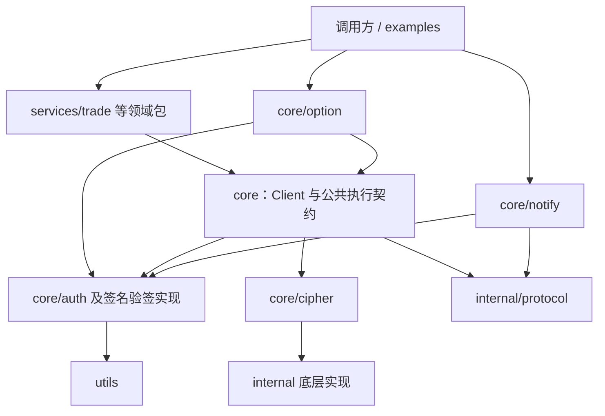
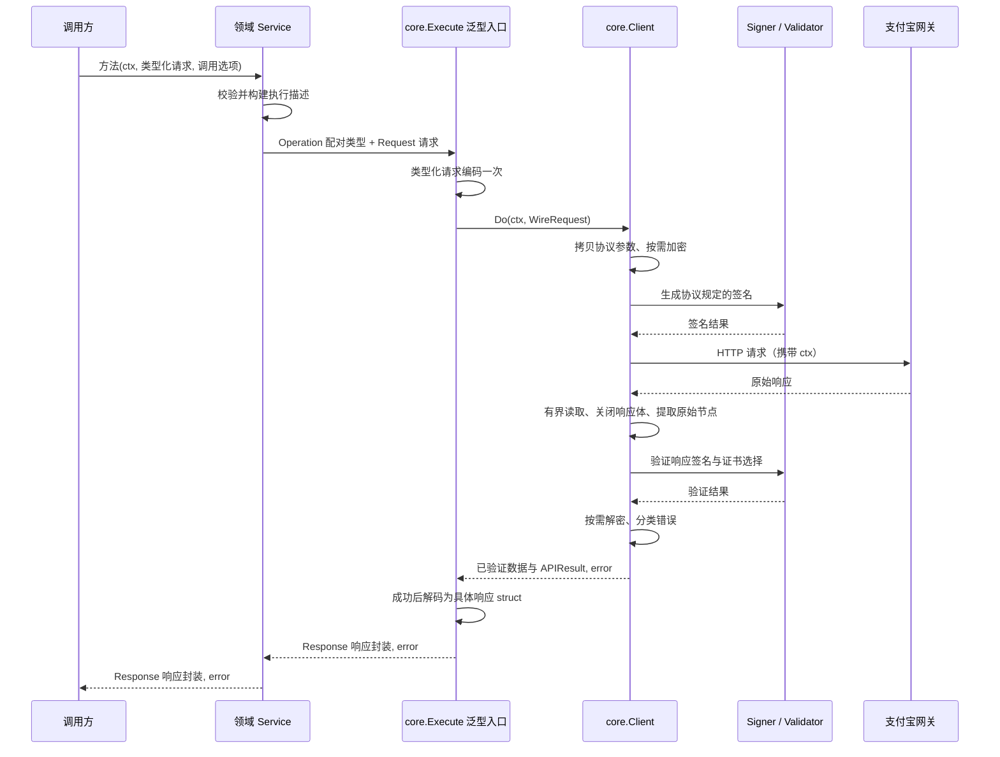

# 整体架构

状态：P0–P4 的现有实现使用 V2；目标已调整为 V3 优先，5 个交易 API 与账单扩展示例需优先迁移，尚未实现 V3。日期：2026-11-05。接口证据见[版本选型](api-versions.md)，实施顺序见[开发计划](development-plan.md)。

## 1. 目标与边界

构建一个可复用、可测试的支付宝第三方 Go SDK，采用 `core.Client` 与领域 API Service 分离的结构。调用方既能使用类型化 Service，也能通过 Client 调用尚未封装的接口，并复用相同的协议、安全和错误处理能力。

接口选型遵循“有官方 V3 就使用 V3，确认只有 V2 才使用 V2”。首个测试版本的交易查询、预下单、退款、退款查询、关闭全部采用已核验的 V3 REST 路由；页面支付、手机网站支付和 App 订单串按各自官方 V3 文档及 `pageExecute` / `sdkExecute` 方式接入，不归类为仅 V2。共享配置、日志与类型化流程，REST 执行和本地签名产物构建分别实现。

SDK 不负责商户订单持久化、分布式锁、业务幂等记录、补单任务、对账调度或资金状态机，也不强制依赖 Web 框架、数据库、缓存与日志框架。页面跳转和 App 唤端能力在后续阶段提供本地签名产物构建接口。

## 2. 已作出的设计选择

| 主题 | 本方案选择 | 理由或边界 |
| --- | --- | --- |
| 工程结构 | 单 Go module，`core/`、`services/`、`utils/` 分层 | 项目、文档与示例统一使用 alipay 命名 |
| Go 版本 | `go 1.27.0`，使用 1.27 系列最新稳定补丁 | 直接采用该版本的正式能力，无旧版本兼容分支 |
| 协议主线 | V3 优先，只有 V2 的能力明确保留 V2 | Operation 固定协议；按官方方法与路由实现，不自动回退 |
| 调用方式 | REST、页面跳转、App 签名数据分别建模 | 文档版本不代替调用方式；V3 SDK 的通用执行支持不能只查 REST 清单 |
| 初始化 | `core.NewClient` 配合 `core/option`；Service 通过构造函数注入 | 配置校验集中，Service 易于替换执行器进行测试 |
| 配置作用域 | Client 级静态配置与请求级选项分开 | 同一 Client 并发调用时，不发生商家令牌与回调地址串用 |
| 数据模型 | 已知数据使用具名 struct，嵌套对象使用具体类型 | 动态键值仅用于协议边界；枚举使用具名类型与带类型常量 |
| 泛型 | 泛型 Client 方法、`Operation[Req, Resp]`、`Request[T]`、`Response[T]` 与编解码器 | 请求与响应在编译期配对，新增接口不修改传输层 |
| 自定义 API | 用户在独立包实现模型、Operation 与 Service | 扩展仅依赖公开包，不要求 SDK 预注册接口名 |
| JSON | `encoding/json/v2` 编解码，`jsontext` 处理原始节点 | 严格校验并保留签名原文，明确空值与字段省略策略 |
| 返回值 | `*Response[T]` 与 error；响应包含类型化数据及调用元信息 | 业务模型与网络诊断分开；本地构建类方法采用对应产物类型 |
| 金额 | 首期采用十进制字符串 | 不引入浮点误差，序列化格式按目标 API 文档确定 |
| 重试 | 默认不自动重试 | 写操作超时不能说明操作未执行 |
| 日志 | 标准库 `log/slog`，注入 Logger 或任意 Handler 实现 | 后端由调用方选择，默认静默，结构化字段经过筛选 |
| 证书更新 | 首期本地可信证书集合；更新后重建 Client | 不引入后台协程、全局下载器或未验证的远端信任 |
| 代码生成 | 首期手写协议核心与代表性 Service | 先验证模型和执行契约，后续再评估稳定的生成来源 |

这些选择包含已有实现与新的迁移目标，不能混同支持状态。协议差异依据官方文档与[版本选型](api-versions.md)中的官方 OpenAPI；V3 不能沿用 V2 的 `biz_content`、签名原文或响应封装。

### 2.1 Go 1.27 特性使用策略

项目固定采用 Go 1.27，优先使用该基线已正式提供且适合 SDK 的能力，不为新语法单独维护旧版本实现。以下是具体落点，并非要求每个模块都使用所有特性：

| 能力 | 使用位置 | 约束 |
| --- | --- | --- |
| 泛型方法 | `Client.Execute[Req, Resp]` | 委托共享执行流程；接口保留非泛型 `Do` |
| `encoding/json/v2` | 类型化请求与响应编解码 | 逐字段验证 `omitempty`、`omitzero`、null、空切片及名称匹配行为 |
| `encoding/json/jsontext` | 原始响应节点和 JSON 扩展片段 | 使用 `jsontext.Value`，验签前禁止 Compact、Canonicalize 或重新编码 |
| `url.Values.Clone` / `url.URL.Clone` | 请求级参数与地址隔离 | 使用深拷贝，避免修改调用方参数和内部切片 |
| `errors.AsType[T]` | 错误分类及使用示例 | 保留标准错误链；不依赖断言恢复业务模型类型 |
| `slog.DiscardHandler` | 默认静默 Logger | 配置为 `slog.New(slog.DiscardHandler)`，不引用全局 Logger |
| `testing/synctest` 与 `httptest.NewTestServer` | 超时、取消与并发测试 | 优先使用虚拟时间和内存网络；不把真实外部网络放入虚拟时间假设 |
| `sync.WaitGroup.Go` | 确有需要的受控并发任务 | 不为采用新 API 引入无必要的后台协程 |

Go 1.27 的泛型方法、JSON 与测试网络能力见[发布说明](https://go.dev/doc/go1.27)，具体 JSON 行为以[标准库文档](https://pkg.go.dev/encoding/json/v2)为准。严格解析不得拒绝平台合法的新增业务字段，也不得放宽重复关键字段、无效 UTF-8 等歧义输入；响应未知枚举值继续保留。

所有新特性均服从支付宝协议：保持签名算法、参数编码和原文不变，不为追求新特性替换平台规定的密码学方案。默认构建不依赖 `GOEXPERIMENT`。

## 3. 目录规划

下列目录按阶段实际需要创建，不提前生成空包。`trade`、`fund`、`oauth` 为领域划分，后续按复杂度再增加子包。

```text
go-alipay/
├── go.mod
├── README.md
├── core/
│   ├── client.go                # 通用执行、HTTP 生命周期
│   ├── settings.go              # Client 配置、ClientOption 契约
│   ├── errors.go                # 可识别错误及原因链
│   ├── type.go                  # 泛型 Request/Response/Operation 与协议元信息
│   ├── execute.go               # Client 泛型方法与共享泛型编解码流程
│   ├── logger.go                # slog 注入、固定日志字段与安全输出
│   ├── option/                  # 配置选项组装
│   ├── auth/
│   │   ├── auth.go              # Signer、Verifier 等小接口
│   │   ├── signers/             # RSA2 实现
│   │   ├── verifiers/           # RSA2 验签与可信密钥选择
│   │   └── validators/          # 响应签名校验
│   ├── cipher/                 # 后续：协议内容加解密
│   └── notify/                 # 通知解析、验签；不含商户订单逻辑
├── services/
│   ├── service.go              # 有实际复用需求时引入的公共容器
│   ├── trade/
│   │   ├── service.go          # 领域构造函数及执行器依赖
│   │   ├── api_trade.go        # API 方法与官方文档链接
│   │   ├── models.go           # 请求、响应及通知 struct
│   │   ├── enums.go            # 领域枚举类型与常量
│   │   ├── api_trade_test.go
│   │   └── api_trade_example_test.go
│   ├── oauth/                  # 后续：用户/应用授权接口
│   └── fund/                   # 后续：资金接口
├── utils/                      # 独立的密钥/证书解析与 SN 工具
├── internal/
│   ├── protocol/               # 参数规范化、原始响应节点提取
│   └── testutil/               # 专用测试材料与协议断言
├── examples/                   # 可独立运行的场景示例
├── cmd/                        # 有实际需求后增加命令行工具
└── docs/
    ├── README.md
    ├── architecture.md
    └── development-plan.md
```

单元测试放在被测实现附近。示例应优先采用领域包的 `*_example_test.go`，仅需要启动 HTTP 服务等场景才放入 `examples/`。

## 4. 包依赖与职责

下图箭头表示允许的导入方向，不表示运行时数据流。



- `core` 不导入 `services`、`core/option` 或 `core/notify`。
- `core/option` 负责将密钥、证书和选项组装为 `core` 定义的配置，不能把基础 Client 绑定到业务包。
- `core/auth` 与底层实现不反向导入 Client；共享的签名契约放在基础包中。
- `core/notify` 接收通用参数或目标模型，不依赖 `services/trade` 的通知结构。
- `utils` 仅提供独立工具，不依赖 `core` 或 `services`。内部专用实现保留在 `internal/`。
- 公共 Service 容器如存在，只保存执行器，不导入领域子包。暂不提供自动注册全部业务 Service 的聚合对象。

### 4.1 Client

Client 统一处理公共参数、编码、签名、HTTP 执行、原始响应提取、验签、可选解密和通用错误解析。Client 可以处理协议层的 `code`，但不得解释商户订单状态，也不得包含退款金额等业务字段。

Client 初始化完成后配置保持稳定，网络连接可复用。请求执行不修改调用方对象；每次调用复制参数并生成独立的时间戳与签名。首期不运行自动刷新任务，避免额外的启动、关闭与协程所有权问题。

### 4.2 Service

领域 Service 定义官方接口名、响应节点名、参数位置、类型化请求/响应和确定的本地校验，通过 `Operation[Req, Resp]` 固定模型配对，再委托通用泛型流程与 Client 执行。明确的必填关系可以本地校验，权限、产品开通状态等动态条件由平台裁决。

Service 内的交易状态和退款状态保持官方语义；查询请求处理成功，不等于支付成功。例如[退款查询接口](https://opendocs.alipay.com/open/02ekft.md)的 `code=10000` 只表示查询成功，不能替代对 `refund_status` 的判断。对于有特殊返回码的接口，执行描述需声明可接受的响应码，再由 Service 暴露其处理中或待查询语义；不能在全局增加“未知码也成功”的宽松规则。

## 5. 公开 API 草案

以下仅展示调用形态，类型定义与具体字段在 P1 固化；不得作为当前可编译示例引用。`any` 仅出现在泛型类型参数约束中，实际业务数据始终是具体 struct。

```go
// core 包：配置构建不进行网络 I/O，因此构造函数不要求 context。
func NewClient(opts ...ClientOption) (*Client, error)

// 传输层使用确定的协议类型，不接收无类型业务输出参数。
type Executor interface {
	Do(ctx context.Context, req WireRequest) (*APIResult, error)
}

type Request[T any] struct {
	Body    T
	Options CallSettings
}

type Response[T any] struct {
	Data   *T
	Result *APIResult
}

// 字段不导出；由具名构造函数校验并建立接口与编解码器的绑定。
type Operation[Req, Resp any] struct {
	spec    OperationSpec
	encoder Encoder[Req]
	decoder Decoder[Resp]
}

func NewJSONOperation[Req, Resp any](spec OperationSpec) (Operation[Req, Resp], error)

// 自定义编解码器入口，允许外部包实现接口，构造函数校验配置一致性。
func NewOperation[Req, Resp any](spec OperationSpec,
	encoder Encoder[Req], decoder Decoder[Resp]) (Operation[Req, Resp], error)

// 包级泛型入口：响应类型从 operation 推导，调用方不能任意替换。
func Execute[Req, Resp any](ctx context.Context, executor Executor,
	operation Operation[Req, Resp], req Request[Req]) (*Response[Resp], error)

// Go 1.27 泛型方法：仅委托共享 Execute，不另行实现协议流程。
func (c *Client) Execute[Req, Resp any](ctx context.Context,
	operation Operation[Req, Resp], req Request[Req]) (*Response[Resp], error) {
	return Execute(ctx, c, operation, req)
}

// services/trade 包：同一执行器可注入多个领域 Service。
func NewService(executor core.Executor) (*Service, error)
func (s *Service) Query(ctx context.Context, req QueryRequest,
	opts ...core.CallOption) (*core.Response[QueryResponse], error)
```

通用调用链为 `具体请求 struct -> Request[Req] + Operation[Req, Resp] -> Execute -> Executor.Do -> Response[Resp]`。领域 Service 使用包内固定 Operation，调用方扩展未封装接口时自行定义请求/响应 struct，并显式构造相应 Operation。

Go 1.27 已支持方法独立声明类型参数，因此提供 `Client.Execute[Req, Resp]` 作为直接调用入口；它仅委托共享的包级 `core.Execute`。领域 Service 通过非泛型 `Executor.Do` 注入执行器并使用相同共享流程，既能测试替身替换，也不重复协议逻辑。接口方法不能声明类型参数，不能将泛型 Execute 放进 Executor 接口。语法依据 [Go 方法声明规范](https://go.dev/ref/spec#Method_declarations)。

### 5.1 数据结构与扩展边界

| 对象 | 内容 | 限制 |
| --- | --- | --- |
| Client 配置 | APPID、环境、网关、Signer/Verifier、HTTP 执行器、超时与响应大小限制、`Logger *slog.Logger` | 不保存调用级商家令牌；公钥与证书模式明确区分 |
| `Operation[Req, Resp]` | 接口描述、请求编码器与响应解码器 | 固定请求/响应类型；零值或无效描述在发请求前失败 |
| `OperationSpec` | 迁移目标包含协议、官方方法名、V3 HTTP 方法/路径、参数模式及各协议专属规则 | 具名 struct；协议、HTTP 方法、参数模式与响应码各自具名；当前实现仍为 V2 描述 |
| `Request[T]` | 具体业务 struct 与本次调用配置 | 不包含动态业务容器，不承载签名与公共身份覆盖值 |
| `CallSettings` / `CallOption` | 当前请求的代调用令牌、通知地址、返回地址和按需加密标志 | 选项构建明确的配置 struct，仅作用于当前调用 |
| `Encoder[T]` / `Decoder[T]` | 具体类型与协议数据之间的转换 | 新增编解码策略不改变网络、安全与错误处理流程 |
| `EncodedParams` | 参数模式、JSON 原始字节或表单参数 | 具名 struct；模式决定有效字段，拒绝冲突输入 |
| `WireRequest` | 接口描述、已编码参数、本次调用配置 | 只处理协议数据；不接收动态业务对象 |
| `Response[T]` | `Data *T` 与 `Result *APIResult` | 所有领域统一使用相同结果封装，失败时不填充可信业务数据 |
| `notify.Notification[T]` | 类型化通知数据与验证元信息 | 泛型解析入口完成验签后才构造业务数据 |

业务请求、响应、配置、错误、通知及嵌套对象采用具名 struct，已知字段不得退化为 `map[string]any`、裸 `any` 或 `interface{}`。泛型约束不改变这一要求：`T` 对应真实业务模型，而非动态字典。

`EncodedParams` 区分 V3 JSON body、V3 query、V2 `biz_content` JSON 和 V2 直接参数。JSON 使用 `jsontext.Value` 保存确定的一份编码结果；query/表单在边界使用 `url.Values`，HTTP 头使用 `http.Header`。动态键名确有需求时保留明确值类型，未知 JSON 片段保留为 `jsontext.Value`，不先解成无类型字典。参数位置必须依据对应协议的具体接口，不将 V2 的 `biz_content` 套入 V3。

类型化表单请求也由 struct 定义，通过显式编码器生成协议参数；不能要求调用方自行创建动态业务参数表。扩展能力通过新的 struct、Operation 或编解码器接入，不需要向 Client 添加业务分支。

可选字段优先使用具体类型指针。确需表达未传、null、零值三态时再引入 `Optional[T]`，并由配套编码器处理字段省略，不能假设 struct 配合 `omitempty` 自动获得三态语义。

### 5.2 枚举类型

枚举采用具名类型定义，配合显式带类型常量；例如交易状态：

```go
type TradeStatus string

const (
	TradeStatusWaitBuyerPay TradeStatus = "WAIT_BUYER_PAY"
	TradeStatusClosed       TradeStatus = "TRADE_CLOSED"
	TradeStatusSuccess      TradeStatus = "TRADE_SUCCESS"
	TradeStatusFinished     TradeStatus = "TRADE_FINISHED"
)
```

上述值依据[交易查询文档](https://opendocs.alipay.com/open/02ekfq.md)。模型中对应字段使用 `TradeStatus`，而不是 `string`。支付方式、退款状态、认证模式、环境、参数模式和公共响应码等同样建立各自的具名类型，避免不同领域的枚举相互混用。

- 使用 `type X string` 或 `type X uint8` 等类型定义；不使用 `type X = string` 这种不能形成独立类型边界的别名声明。
- 协议枚举写明官方值，不用 `iota` 自动推导；纯内部枚举可使用 `iota`。枚举所属业务包负责导出命名和值。
- 不把所有状态都归为同一个通用 `Status` 类型，也不把未知值转换成某个已知状态。
- 请求值按目标接口允许范围校验；响应保留未识别的原始值，调用方应能在 `switch` 的默认分支识别新值。可以提供 `IsKnown` 等辅助方法，不因新增响应枚举值自动拒绝整份响应。
- 测试验证精确的协议值、序列化结果、未知值保留，以及不同枚举类型之间的类型边界。

### 5.3 结果与失败语义

`APIResult` 保存 HTTP 状态、必要响应头、官方提供时的请求标识，以及签名验证状态。原始报文属于敏感诊断数据，若开放访问，应明确其敏感性与生命周期，不自动打印，也不混入错误字符串。Client 负责读取并关闭响应体；元信息不承诺响应体仍可读取。

失败时的约定：

- 构造失败不发送请求；参数或签名失败时可能没有 HTTP 元信息。
- 收到响应后即使执行失败，也可返回已经获得的元信息。
- 验签、解密或解析失败时，`Response[T].Data` 为 nil；已获得元信息时仍可返回结果封装，失败原因通过 error 表达，调用方先检查 error 再访问 Data。
- 业务失败保留官方码；本地错误通过原因链提供诊断，不依赖调用方匹配字符串。

### 5.4 用户自定义接口

未内置 API 的扩展属于首期公共契约，随 P1/P2 落地。用户在自己的包中定义请求/响应 struct、具名枚举与 Operation，直接调用 `Client.Execute` 或封装自己的 Service。无需修改 SDK 源码、导入内部包或注册全局接口表。

- 通常的 JSON 业务参数使用 `NewJSONOperation[Req, Resp]`，由 SDK 提供默认编解码器。
- V3 迁移后 Operation 必须声明协议、HTTP 方法及路由，GET 接口使用 query 编码构造入口；不能仅填写 V2 方法名和响应节点来调用 V3。
- 直接参数或特殊业务字段使用 `NewOperation[Req, Resp]`，由用户实现公开的 `Encoder[Req]` / `Decoder[Resp]`。
- 编解码接口与协议输入/输出类型全部公开，不包含私有方法，避免名义上可扩展但外部包无法实现。
- Client 不以已封装方法清单限制调用；方法描述、编码方式与响应规则需要校验，认证权限仍由支付宝决定。
- 用户负责接口文档、业务模型和校验；SDK 统一执行公共参数、签名、验签、证书、HTTP、slog 与错误处理，自定义解码器仅接收通过验证和必要解密的业务节点。
- 扩展不提供跳过安全流程的回调，也不能覆盖 APPID、签名或证书参数。新的业务方法按版本清单优先选择 V3；当前尚未完成的 V3、上传或流式能力必须明确报为未支持，不能隐式切回 V2。

公开构造与使用示例见[自定义接口扩展](custom-apis.md)。P1/P2 必须通过外部测试包验证扩展，不以 SDK 内部测试替代用户实际导入场景。

## 6. 同步 API 调用流程（现有 V2）

以下为当前 V2 执行流程。V3 迁移后在通用执行入口按 Operation 协议选择独立处理器：使用官方 HTTP 方法、路由、JSON body/query、V3 鉴权与响应规则，不执行 V2 的参数排序、`xxx_response` 提取及公共成功码判断。两条协议流程都在验证通过后才调用用户解码器。



实现重点：

1. 同一份序列化结果同时用于待签名串与传输，不在签名后重新编码业务 JSON。
2. 请求参数筛选、排序、签名与 URL 编码分阶段执行。不能通过提前 URL 编码修复不一致，也不能擅自裁剪非空业务值。
3. 使用协议感知的 JSON 解析保留响应节点的原始字节，拒绝歧义封装及重复关键节点。不能依赖正则截取 JSON，也不能重新序列化后验签。
4. 根据预期节点或协议规定的错误节点判断报文，不信任任意同名后缀字段。缺签的成功报文失败；未签名错误仅以“未验证的平台错误”暴露诊断信息。
5. 签名错误优先于业务成功；HTTP 非成功状态也不得进入成功路径，有限读取其报文以生成诊断。

RSA2 与请求处理依据[签名规范](https://opendocs.alipay.com/common/057k53.md)，同步响应原文处理依据[验签规范](https://opendocs.alipay.com/common/02mse7.md)。

## 7. 本地支付产物与通知

### 7.1 页面与 App 支付

后续通过独立的构建入口生成支付 URL、HTML Form 或 App 订单字符串，复用公共参数与签名能力，但不调用服务端 HTTP 执行入口。建议分别命名为 `BuildPageURL`、`BuildPageForm`、`BuildAppOrder`，最终名称在对应阶段固化。

接入依据为官方 V3 [page.pay](https://opendocs.alipay.com/open-v3/2423fad5_alipay.trade.page.pay)、[wap.pay](https://opendocs.alipay.com/open-v3/1a957be0_alipay.trade.wap.pay)、[app.pay](https://opendocs.alipay.com/open-v3/429e4d75_alipay.trade.app.pay) 及 V3 SDK `GenericExecuteApi`。页面接口明确返回 `pageRedirectionData`，App 返回 `orderStr`，不因生成器 REST 清单中缺少它们就标记仅 V2。

调用方式采用具名枚举与相应产物类型区分，页面构建不伪造 `/v3/...` REST 路由。签名产物按文档保留 `method`、`version=1.0`、`biz_content` 等实际格式。HTML Form 使用安全模板转义，页面返回地址不作为支付完成的可信证据。

### 7.2 支付异步通知

通知处理链路为：限制请求体大小 → 解析一次表单 → 按通知类型构建验签原文 → 使用可信支付宝公钥或证书验签 → 形成可信参数 → 映射领域通知模型 → 调用方校验并幂等处理 → 按产品规范确认通知。

- 首期仅实现普通支付通知；生活号等类型以后显式增加策略，不自动猜测通知类型。
- 普通支付通知与生活号通知对 `sign_type` 的处理不同，不能共用一个固定剔除规则。[官方验签文档](https://opendocs.alipay.com/common/02mse7.md)明确说明了此差异。
- 从原始请求体解析的入口与接收已解码参数的入口需要明确命名，防止二次 URL 解码。重复参数默认拒绝歧义，不能静默选择首项或末项。
- 领域通知模型由 `services/trade` 定义。调用方显式选择与当前 APPID 对应的处理器，不直接信任通知里的身份来选择任意凭证。
- 通知采用包级泛型 `notify.Parse[T]` 与 `notify.Notification[T]`，通过领域 struct 和相应表单解码器映射字段，泛型流程统一处理校验顺序；解析失败不输出可信业务数据。
- 验签只是可信来源校验。示例必须继续检查 APPID、收款方、商户订单、金额，完成幂等持久化后才确认；重复通知、乱序与响应失败交给商户业务处理。

## 8. 密钥、证书与加密

| 能力 | 设计 |
| --- | --- |
| 公钥模式 | 配置应用私钥与支付宝公钥；缺少必要材料时初始化失败 |
| 私钥格式 | 首期支持文档规定的 PKCS#8 PEM；其他格式按实际需求显式增加并测试 |
| RSA2 | 使用标准库的 RSA PKCS#1 v1.5 与 SHA-256，不使用 RSA-PSS 替代协议算法 |
| 证书模式 | 配置应用证书、支付宝证书和支付宝根证书，校验私钥与应用证书的匹配关系 |
| 证书 SN | 按支付宝规则计算和选择，不能直接使用 X.509 内置序列号代替；根证书集合规则单独测试 |
| 证书轮换 | 允许提供有效的可信证书集合；未知 SN 返回错误，由调用方更新材料后重建实例 |
| 内容加密 | 后续独立实现；请求先加密再签名，响应先验签再解密 |

证书计算依据[密钥与证书常见问题](https://opendocs.alipay.com/common/02kdne.md)。算法和格式依据[签名规范](https://opendocs.alipay.com/common/057k53.md)及[密钥与证书格式说明](https://opendocs.alipay.com/common/058isw.md)。若后续提供证书下载，下载必须建立在可信来源、证书链校验及 SN 校验上，不因更新失败放宽验签。

内容加密应按[官方内容加密文档](https://opendocs.alipay.com/common/02mse3.md)核对密钥、填充、IV、Base64 与加密响应的签名原文。首期未提供加密时，调用方请求该能力应返回明确的不支持错误。

## 9. 错误、网络与资源管理

| 分类 | 建议类型 | 核心行为 |
| --- | --- | --- |
| 配置/参数 | `ConfigError` / `ValidationError` | 指出无效字段，不输出字段中的秘密值 |
| 传输 | 包装底层网络错误 | 保留 `context.Canceled`、`context.DeadlineExceeded` 与网络错误原因链 |
| HTTP | `HTTPError` | 保留状态码和有界诊断，不将 HTML/错误响应当成成功数据 |
| 协议 | `ProtocolError` | 包括格式异常、预期节点缺失、响应超限 |
| 安全 | `SignatureError` / `CertificateError` / `DecryptError` | 默认失败，不降级、不填充可信业务响应 |
| 平台业务 | `APIError` | 保留 `code`、`msg`、`sub_code`、`sub_msg`，并标注是否已验签 |

公共错误码依据[官方说明](https://opendocs.alipay.com/common/02km9f.md)。代码优先通过 `errors.AsType[T]` 匹配错误类型，通过 `errors.Is` 判断原因，不依赖日志或错误字符串分支。

- 环境必须显式选择；网关、APPID 与凭证属于同一配置，不在失败后自动切换沙箱或生产。
- 网关常量按[沙箱接入说明](https://opendocs.alipay.com/common/097jyh.md)与签名规范维护，支持显式覆盖用于测试或受控代理。
- 默认使用带有限超时的专用 HTTP Client。初始建议总超时 30 秒、普通 JSON 响应上限 8 MiB，均为可配置的工程默认值，不是平台协议限制；文件下载另行设计。
- 注入 HTTP 执行器时由调用方管理其连接和超时策略，SDK 仍传递 ctx 并关闭所接收响应体。SDK 不关闭调用方共享的 Transport。
- 默认拒绝自动重定向，防止携带凭证的请求意外发往其他地址；测试服务器可通过明确配置注入。
- 不禁用 TLS 校验，不默认重试。超时或连接断开后的结果应由商户通过查询接口确认。
- 日志统一通过注入的 slog Logger 输出经过筛选的元信息，原始请求与响应由调用方显式处理。

### 9.1 日志接入

采用标准库 [log/slog](https://pkg.go.dev/log/slog) 作为统一日志契约。支持任何符合 `slog.Handler` 接口的标准或第三方实现，由 `slog.New(handler)` 包装为 Logger，不为特定后端增加 SDK 依赖，也不另建一套同义 Logger 接口。

`core/option` 提供以下配置入口草案；两个入口最终设置同一个 `Logger *slog.Logger` 字段，多次设置时最后一个有效选项生效，显式传入 nil 作为配置错误处理：

```go
func WithLogger(logger *slog.Logger) core.ClientOption
func WithLogHandler(handler slog.Handler) core.ClientOption
```

- 未配置 Logger 时使用 `slog.New(slog.DiscardHandler)`，不隐式读取 `slog.Default()`，不调用 `slog.SetDefault`，不修改调用方 Logger 的全局状态。调用方可以显式传入自己的默认 Logger。
- Client 与通知处理器采用相同的 slog 注入方式；Service 不自行创建日志后端或逐层重复记录同一失败。
- 通过实例 Logger 的 `LogAttrs(ctx, ...)` 传递调用上下文，并用 `slog.String`、`slog.Int`、`slog.Duration` 等属性构造器输出结构化字段。日志不使用无类型业务字典。
- 最小字段为 `sdk=alipay`、`operation`、`duration`；获得响应后可增加 `http_status`、`code`、`sub_code`，失败时增加具名错误分类对应的 `error_kind`。不存在的字段省略，不伪造请求标识。
- 成功调用的诊断信息使用 Debug，平台业务拒绝使用 Warn，网络、协议和安全失败使用 Error；主动取消单独归类为 Debug。级别过滤、输出格式、目标和从 ctx 提取追踪信息由 Handler 实现。
- 仅使用预先筛选的诊断字段，不直接记录 `err.Error()`、平台自由文本消息、完整 URL、请求头、报文、签名原文、凭证或个人信息；提高日志级别不会解除此限制。
- 按 slog 的并发契约调用 Logger，Handler 自行保证并发安全。遵循标准 Logger 对 Handler 错误的处理语义，日志失败不替代支付调用结果；SDK 不负责关闭、刷新或轮转调用方的日志资源。

日志直接使用 Go 1.27 基线提供的标准库能力。日志配置契约在 P1 建立，在 P2 接入执行链路，在 P4 接入通知处理。

## 10. 测试设计与演进

| 层 | 必须证明的行为 |
| --- | --- |
| 密码学 | 独立已知答案向量、标准验签工具交叉验证、篡改/错钥/错签失败 |
| 协议 | 编码与签名一致、原始 JSON 验签、异常封装、错误节点、空值与零值处理 |
| Client | context 传播、超时、HTTP 错误、有限读取、响应体关闭与并发隔离 |
| Service | 官方接口名、字段位置、请求模型和响应映射、确定的校验规则 |
| 类型契约 | 泛型 Operation 的请求/响应配对、具体 struct 编解码、枚举协议值与未知响应枚举保留 |
| 自定义 API | 外部包仅依赖公开类型定义模型、实现编解码器和 Service；验签与错误策略与内置接口一致 |
| 日志 | 自定义 slog.Handler 接入、ctx 传递、级别过滤、默认静默、字段脱敏、并发与 Handler 错误隔离 |
| 通知 | 单次解码、特殊字符、重复参数、错误签名、身份与金额校验示例 |
| 证书 | SN 向量、证书链及期限策略、密钥匹配、多证书选择、未知 SN 失败 |

默认测试离线；真实沙箱以显式开关和环境变量启用，未配置时跳过，并与单元测试结果分开记录。沙箱通过不意味着生产已验收。

下一里程碑优先新增 V3 协议处理器，将已有 5 个交易接口及账单扩展示例迁移到 V3，再继续证书完善和测试版本交付。迁移通过显式协议描述与文档管理，不在运行时回退或跨协议重试；新接口按版本清单选型。上传、账单文件下载、流式处理与证书自动更新仍需单独评估资源生命周期。
