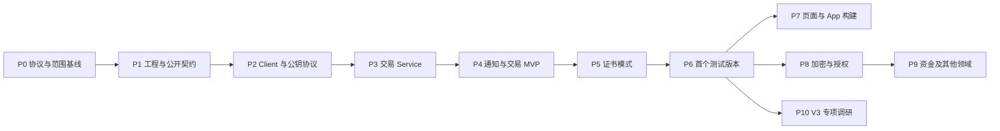

# 开发计划

状态：模块与 Go 1.27 基线已配置，SDK 代码任务尚未开始。日期：2026-11-05。设计依据见[整体架构](architecture.md)。

## 1. 交付范围与假设

建议按“协议基座 → 交易闭环 → 证书 → 首个测试版本 → 扩展能力”推进。首期使用传统网关 OpenAPI，暂不同时开发 V3。此顺序是本方案的规划假设，后续可根据实际接入场景调整，不代表已经确认所有产品权限。

| 交付点 | 范围 | 不作为该交付点的完成条件 |
| --- | --- | --- |
| 交易 MVP（P4 完成） | 公钥 RSA2、通用执行与自定义 API 入口、5 个交易 API、普通支付通知、离线测试及示例 | 证书、页面/App 构建、资金与授权能力 |
| 首个测试版本（P6 完成） | MVP + 本地证书模式 + 工程检查、覆盖记录、沙箱验收说明 | 自动证书下载、全量 API、V3、生产验收 |
| 扩展版本（P7 起） | 按实际需求补充页面/App、加密、授权、资金等 | 未排入具体迭代的候选能力 |

不将“支持支付宝”解释为支持全部 OpenAPI。每次发布需要给出准确的接口、认证模式、协议和通知类型覆盖范围。

所有阶段的数据建模统一采用具名 struct，枚举使用 `type X string` 等具名类型及带类型常量；通用调用、编解码与通知结果通过泛型复用，动态键值限制在协议边界。项目命名、示例和文档统一使用 alipay 或支付宝。

用户自定义未内置 API 的能力纳入 P1/P2，不延后到领域接口扩展阶段。用户可以在自己的包中实现模型、Operation、编解码器与 Service，复用相同执行流程；详见[扩展方案](custom-apis.md)。

Go 版本固定为 1.27，`go.mod` 声明 `go 1.27.0`，开发与 CI 使用该系列最新稳定补丁。实现优先采用泛型方法、JSON v2、标准库深拷贝、泛型错误匹配和确定性的并发测试能力；不增加旧版本兼容分支或实验特性默认依赖。

## 2. 当前状态与资料核验

- 已建立 `go.mod`，声明模块 `github.com/tiyee/go-alipay` 和 `go 1.27.0`；尚无 SDK 源码、测试或 CI。
- module 路径与当前 remote 一致；本机工具链为 Go 1.27.3，具体补丁版本不写成 SDK 的最低语言版本。
- 已读取支付宝[索引](https://opendocs.alipay.com/common/llms.txt)、[摘要](https://opendocs.alipay.com/common/llms-full.txt)及签名、验签、加密、证书常见问题、沙箱、页面跳转和唤端说明。
- 本次读取部分 `/apis/.../*.md` 与 V3 入口时取得空内容，随后通过官方 Demo 找到并取得交易查询、关闭、退款和退款查询的可读正文。预下单的具体接口正文与 V3 细节仍待定位；不以 HTTP 200 判定资料已经读取成功。
- 官方[手机网站 Demo](https://opendocs.alipay.com/common/02kkv5.md)给出了可用的具体 API 链接。已确认查询和退款查询的状态语义，完整字段、条件必填、权限和沙箱支持仍应在 P0 逐项记录为契约基线。

对单个 API，开发开始条件是取得可核对的官方接口说明。若一个接口资料暂不可得，继续其他已具备依据的任务，覆盖表中保留该接口的未确认状态。

## 3. 阶段与依赖

图示为建议交付顺序。证书工作技术上依赖 P2，可在交易 MVP 之前提前开展；资金接口仅依赖已验证的证书与目标接口所需能力，不强制启用内容加密。P10 是调研入口，不能在未完成契约核验时直接扩展实现。

## 4. P0：协议与范围基线

目标：把首期范围和实现依据固定下来，避免先造模型再寻找文档。

- [ ] 核对首期 5 个交易 API 的官方方法名、版本、请求位置、响应节点、业务码、授权与沙箱支持。
- [ ] 记录公钥、证书、普通支付通知的签名原文规则与差异。
- [ ] 明确首期只支持 UTF-8 JSON 与 RSA2；对 GBK、XML、历史算法和其他通知类型列为未支持。
- [x] 确定并配置 module 路径与 Go 1.27.0 基线。
- [ ] 配置 CI 使用 Go 1.27 系列最新稳定补丁，落实 HTTP 默认限制。
- [ ] 基于 Go 1.27 标准库确定日志字段、错误分类、级别和敏感字段排除规则。
- [ ] 为首期接口整理具体 struct、嵌套类型、枚举类型及其官方取值，确认可选字段语义和未知响应枚举的兼容方式。
- [ ] 创建 `docs/api-coverage.md` 与 `docs/protocol-notes.md`，分别记录接口覆盖和协议依据。
- [ ] 从官方示例及独立签名工具整理无真实凭证的测试向量。

验收：5 个接口都能追溯到完整契约；未确定项单列。版本基线已固定为 Go 1.27.0，后续完成协议契约核验与 CI 配置约定。

## 5. P1：工程骨架与公开契约

- [x] 初始化单一 Go module，并声明 `go 1.27.0`；未添加第三方依赖。
- [ ] 实现具名配置 struct、`ClientOption`、`CallOption`、`Request[T]`、`Response[T]`、`APIResult` 和错误契约。
- [ ] 固化 `Operation[Req, Resp]`、泛型 `Encoder[T]` / `Decoder[T]` 与共享 `Execute`，在编译期绑定请求/响应。
- [ ] 提供 Go 1.27 的 `Client.Execute[Req, Resp]` 泛型方法，委托共享流程，保持 `Executor.Do` 为非泛型接口方法。
- [ ] 固化 JSON v2 编解码选项和 `jsontext.Value` 原文处理规则，核对 `omitzero`、`omitempty`、null、空切片和字段匹配。
- [ ] 固化只接收明确协议类型的 `Executor.Do` 与 Service 构造函数，明确 nil 执行器、无效 Operation 及配置的失败行为。
- [ ] 公开 `OperationSpec`、`EncodedParams`、具名协议枚举和编解码接口，提供 `NewJSONOperation` 与 `NewOperation`；外部包无需引用内部实现即可扩展。
- [ ] 定义环境、认证模式、参数模式与公共响应码的具名枚举类型及带类型常量。
- [ ] 拆分 Client 配置与调用选项，确定受保护公共参数列表及冲突处理。
- [ ] 建立 `WithLogger(*slog.Logger)` 与 `WithLogHandler(slog.Handler)` 注入契约，任意合规 Handler 均可使用；未配置时静默，不依赖全局 Logger。
- [ ] 建立 `core/option -> core` 的依赖方向，验证不存在反向导入。
- [ ] 配置基础 CI：格式检查、`go test ./...`、`go vet ./...`；支持环境上运行竞态检测。
- [ ] 建立最小公开 API 使用示例和测试辅助约定。

验收：包在 Go 1.27 工具链上可编译；错误可通过 `errors.AsType[T]` 识别；配置在发请求前校验；领域包可注入模拟执行器。泛型方法与共享入口行为一致；已知数据采用具体 struct，枚举字段使用对应类型，不存在无类型业务输出参数；请求/响应错配不能通过编译。此阶段尚不声称具备真实接口调用能力。

## 6. P2：Client、公钥签名与同步响应

- [ ] 实现 PKCS#8 私钥和支付宝公钥解析、RSA2 Signer/Verifier。
- [ ] 使用 `url.Values.Clone`、`url.URL.Clone` 等标准库能力隔离请求参数，落实排序、序列化、公共参数和请求级选项合并。
- [ ] 区分 `biz_content` 和直接参数编码，拒绝受保护字段覆盖及冲突输入。
- [ ] 实现 HTTP 执行器注入、ctx 传递、有限超时、响应大小限制、读取与关闭、重定向策略。
- [ ] 提取原始响应节点并验签，覆盖节点缺失、重复关键字段、无效 JSON 和错误签名。
- [ ] 实现 HTTP、协议、安全与平台错误分类；未签名错误保持未验证标记。
- [ ] 对预期业务码和接口特定可接受码建立明确策略，禁止将所有 HTTP 200 视为业务成功。
- [ ] 实现包级泛型执行入口与 `Executor.Do` 的衔接；未封装 API 通过自定义 struct 和 Operation 接入相同签名验签流程。
- [ ] 明确 JSON 原始片段、表单和 HTTP 头的编码边界；通用扩展不引入无类型业务字典。
- [ ] 用外部测试包实现未内置 API 的 JSON 与直接参数两类扩展，验证不修改 SDK、不注册全局方法表即可调用，返回类型保持明确。
- [ ] 验证用户自定义解码器仅在验签及必要解密后执行；错签、证书错误和受保护参数覆盖仍按统一策略失败。
- [ ] 覆盖并发请求、输入不被修改、令牌和回调地址隔离测试。
- [ ] 优先用 `testing/synctest` 与 `httptest.NewTestServer` 验证超时和取消，减少真实等待；独立确认原始 JSON 验签与 v2 编码行为。
- [ ] 使用实例 slog Logger 的带 context 方法记录筛选后的结构化字段；通过自定义 Handler 验证上下文、级别、默认静默、敏感信息排除及 Handler 错误不改变 API 结果。

验收：本地 `httptest` 服务能独立校验 SDK 请求，并返回独立构造的签名响应；正确报文通过，篡改报文失败。取消、超时、超限、HTTP 错误和资源关闭均有测试证据；正常调用不输出秘密信息。

## 7. P3：交易 Service

按以下顺序实现，不直接由单个大文件覆盖所有支付宝 API：

| 顺序 | 官方接口 | 计划 Go 方法 | 关键验收 |
| --- | --- | --- | --- |
| 1 | [`alipay.trade.query`](https://opendocs.alipay.com/open/02ekfq.md) | `trade.Service.Query` | 订单标识至少一项，两者同传时按官方优先级；查询成功与交易状态分离 |
| 2 | `alipay.trade.precreate` | `trade.Service.Precreate` | 金额保持精确，二维码等输出按契约映射 |
| 3 | [`alipay.trade.refund`](https://opendocs.alipay.com/open/02ekfs.md) | `trade.Service.Refund` | 退款标识由调用方稳定提供；失败与处理中语义按文档暴露 |
| 4 | [`alipay.trade.fastpay.refund.query`](https://opendocs.alipay.com/open/02ekft.md) | `trade.Service.QueryRefund` | `code=10000` 仅表示查询成功，退款结果需结合 `refund_status`，不能直接认定已退款 |
| 5 | [`alipay.trade.close`](https://opendocs.alipay.com/open/02ivbu.md) | `trade.Service.Close` | 用于未付款交易，不在 SDK 根据本地状态自动发起关单 |

上述方法名是设计命名；请求字段、必填条件和业务状态仍需逐项形成契约记录。表内四个具体 API 链接本次已取得可读正文，预下单从[当面付接入资料](https://opendocs.alipay.com/common/02kkv3.md)继续定位具体接口。

- [ ] 为每个方法添加类型化请求/响应、GoDoc 和具体官方链接。
- [ ] 每个接口通过固定 `Operation[Req, Resp]` 调用，统一返回 `*core.Response[Resp]` 与 error；嵌套字段明确到具体 struct 和切片元素类型。
- [ ] 交易状态、退款状态及其他枚举使用领域具名类型与带类型常量；增加协议值序列化、未知响应值保留和请求枚举校验用例。
- [ ] 通过模拟执行器验证方法名、版本、参数位置、响应映射和调用选项。
- [ ] 为每个接口补充正常与业务失败用例；含中文、零值、可选字段及金额序列化边界。
- [ ] 提供可编译示例，避免默认测试发出真实请求。
- [ ] 更新接口覆盖表，状态区分“已实现”“离线验证”“沙箱验证”。

验收：5 个接口均走统一泛型执行流程与 Client；Service 无额外 HTTP、签名或验签实现；模型、枚举值与具体文档可核对，无以动态字典替代已知字段的模型。

## 8. P4：普通支付通知与交易 MVP

- [ ] 实现 `core/notify` 的原始表单解析、参数验签与可信结果输出。
- [ ] 显式支持普通支付通知规则，拒绝未支持的通知策略。
- [ ] 在 `services/trade` 提供通知模型及映射方法，保持基础通知包不依赖业务包。
- [ ] 提供泛型 `notify.Parse[T]` 与 `notify.Notification[T]`，领域通知采用具体 struct，复用验证流程而不抹除类型。
- [ ] 通知处理器复用 slog 注入与安全字段约定，验证不会记录原始通知或重复输出凭证、个人信息。
- [ ] 覆盖 `+`、`%2B`、`%26`、中文、空值、重复参数、缺签、错签和错公钥。
- [ ] 编写最小 `net/http` 示例，展示身份、收款方、订单及金额校验和幂等处理的接入位置。
- [ ] 编写预下单 → 通知/查询确认 → 退款 → 退款查询的场景说明。
- [ ] 对关闭操作提供独立的未支付订单示例，不将已支付订单放入关闭流程。

验收：本地端到端交易模拟链路通过；示例不会仅凭前端返回或验签结果确认订单成功。此时交付“公钥模式交易 MVP”，并明确未包含证书和其他能力。

## 9. P5：本地证书模式

- [ ] 实现应用、支付宝及根证书的装载、基本有效性与用途校验。
- [ ] 校验应用私钥与应用证书公钥匹配。
- [ ] 按官方规则计算 `app_cert_sn`、`alipay_root_cert_sn` 和支付宝证书 SN；使用独立预期值验证。
- [ ] 请求携带证书参数，响应依据 `alipay_cert_sn` 选择可信证书。
- [ ] 定义本地可信材料的链、期限和根证书集合处理策略，并记录依据。
- [ ] 验证过期、格式错误、未知 SN、错误根证书及多证书选择失败行为。
- [ ] 复用交易与通知用例验证证书模式，不重新实现一套 Service。
- [ ] 给出更新本地证书、重建实例的操作说明；不启用自动下载器。

验收：同一领域 Service 可使用公钥或证书 Client；证书缺失或不匹配导致明确错误，不能转为无验签调用。证书规则依据[官方常见问题](https://opendocs.alipay.com/common/02kdne.md)。

## 10. P6：首个测试版本

- [ ] 补全 README、能力矩阵、初始化、错误处理、取消超时、通知和证书更新说明。
- [ ] 补充标准 slog 与自定义 Handler 的接入示例，说明默认静默、过滤规则及调用方的资源管理职责。
- [ ] 将自定义 API 示例落实为仅依赖公开包的可编译示例，包含自定义 Service、错误处理及协议支持边界。
- [ ] 在 Go 1.27 系列最新稳定补丁上执行 CI，校验 `go.mod` 语言基线；验证默认测试完全离线且无需 `GOEXPERIMENT`。
- [ ] 执行 `go test ./...`、`go vet ./...`、适用的 `go test -race ./...`，确认改动文件格式正确。
- [ ] 检查无真实凭证、付款码或个人数据，无默认完整报文日志。
- [ ] 显式启用沙箱，使用匹配的应用、凭证、网关和产品权限验收；公钥/证书测试配置与结果分别记录。
- [ ] 记录查单、退款、退款查询和未支付订单关闭场景。通知需要可访问的回调端点，无法完成时单列未验证项。
- [ ] 审查公开 API 与 GoDoc，整理 CHANGELOG 及已知限制。

验收：构建和离线检查通过，支持范围与证据一致。具备沙箱条件时完成对应验证；缺少凭证或权限时可交付代码与候选版本，但不得标注“已沙箱验收”。实际打 tag 或发布模块属于后续明确的发布操作，本计划不触发发布。

## 11. 后续阶段

| 阶段 | 工作包 | 前置条件 | 验收重点 |
| --- | --- | --- | --- |
| P7 页面/App | `alipay.trade.page.pay`、`alipay.trade.wap.pay`、`alipay.trade.app.pay` 的本地签名构建 | P2 稳定；目标接口契约已核验 | URL、表单和订单串可独立校验；不误发服务端支付请求；HTML 安全转义 |
| P8a 内容加密 | AES 内容加解密与签名执行顺序 | P2；目标接口加密规范已核验 | 请求先加密再签名、响应先验签再解密；边界与异常填充失败测试 |
| P8b 授权 | 用户授权令牌与第三方应用授权接口 | P2；各接口参数位置及权限已核验 | 直接参数编码、令牌请求级隔离、不日志泄露；刷新策略不使用全局状态 |
| P9 资金/扩展 | 转账及其查询、账单地址查询、其他高频接口 | P5；逐项确认权限、幂等及证书要求 | 超时后查询语义、受控沙箱验证，绝不默认重试资金写操作 |
| P10 V3 | 产品覆盖与协议专项调研，形成独立设计后选择代表性接口实现 | P6；取得可读取的 V3 完整契约 | 独立鉴权、编码、响应验签与错误模型；传统网关行为保持兼容 |
| 按需 | 文件上传、流式下载、证书自动更新、代码生成、CLI | 明确使用场景及资源约束 | 生命周期、限流/大小限制、可信链或生成可重复性有专项测试 |

授权与资金接口的精确清单在对应阶段确定，不从常用命名推测契约。资金支出安全要求参考[官方说明](https://opendocs.alipay.com/common/02kg66.md)，加密参考[官方内容加密文档](https://opendocs.alipay.com/common/02mse3.md)，页面与 App 参考[跳转](https://opendocs.alipay.com/common/0i2kxr.md)和[唤端](https://opendocs.alipay.com/common/0i2jez.md)规范。

## 12. 工期估算

估算基于 1 名熟悉 Go 和支付接口的开发者，包含编码、离线测试和文档；不包含等待权限、凭证、公网通知端点及外部验收的时间。它是规划量级，不是交付日期承诺。

| 阶段 | 有效人日估算 |
| --- | --- |
| P0 范围与协议核验 | 1–2 |
| P1 工程与公开契约 | 2–3 |
| P2 Client 与公钥协议 | 4–6 |
| P3 交易 Service | 3–5 |
| P4 通知与 MVP | 3–4 |
| P5 证书模式 | 4–6 |
| P6 测试版本整理 | 2–3 |

公钥交易 MVP 合计约 **13–20 人日**；包含证书的首个测试版本累计约 **19–29 人日**。复杂证书兼容和文档核验耗时可能扩大估算；完成 P0 后重估。P7 之后按确认后的接口数量和契约复杂度单独排期。

## 13. 验收矩阵与完成标准

| 验证层 | 证据 | 必须覆盖 |
| --- | --- | --- |
| 静态工程 | 格式、编译、vet、适用 Go 版本 CI | 导入方向、公开示例、无意外依赖 |
| 密码学 | 独立向量和交叉验证记录 | 正确签名与篡改失败，避免同一实现自证 |
| 协议与网络 | `httptest`、错误分支、资源断言 | 编码、原文验签、HTTP 错误、取消、超时、关闭与超限 |
| 业务封装 | 表驱动测试、接口文档链接 | 接口名、参数位置、字段类型和状态语义 |
| 类型契约 | Go 1.27 编译、泛型方法/配对与 JSON v2 编解码检查 | struct 嵌套类型、枚举常量及字段类型、未知响应值保留、无动态业务容器 |
| 自定义接口 | 外部包编译与独立端到端用例 | JSON/直接参数扩展、无需 SDK 改动、统一验签和错误处理、无内部依赖 |
| 并发 | 竞态检测与请求隔离断言 | 无调用方输入修改、无跨商家参数污染 |
| 日志 | 自定义 slog.Handler 捕获与错误用例 | 实现兼容、ctx/级别传递、默认静默、脱敏、日志错误不替代 API 结果 |
| 通知 | 原始表单与错误通知用例 | 单次解码、重复参数、可信结果和业务校验示例 |
| 真实集成 | 独立沙箱验收记录 | 网关/凭证隔离、具体接口和模式覆盖；未执行则明确注明 |

每个任务完成都需要：实现与范围一致、必要测试通过、公开 API 有 GoDoc 和官方依据、覆盖表更新、无真实凭证及无关改动。阶段验收是交付证据检查，不额外引入逐阶段人工审批或生产资金操作。

P0 创建覆盖表时建议使用以下列：接口名、协议版本、具体官方链接、文档核验日期、请求编码、支持授权模式、实现状态、离线测试、沙箱结果、限制。不能仅用一个“已支持”列合并上述状态。

## 14. 主要风险与处理

| 风险 | 处理方式 |
| --- | --- |
| API 文档不可访问或摘要与正文不一致 | 优先定位可访问的官方正文；未确认字段不实现为稳定契约 |
| 请求编码与签名不一致 | 保留单份序列化产物，使用特殊字符和独立服务端验证 |
| JSON 重建导致验签失败 | 保留原始节点，覆盖转义、空白及异常封装 |
| 证书 SN、根证书集合或轮换规则错误 | 建立独立证书向量；未知证书失败；首期本地管理 |
| 超时后重复资金操作 | 默认不重试，明确查询与商户幂等职责 |
| 沙箱权限或产品能力不足 | 分开记录离线与沙箱结果，调整验收范围而不虚报通过 |
| 公开模型过早固化 | P1 用查询/预下单代表性契约验证，再扩展领域；发布前审查 |
| V3 过早泛化影响首期交付 | 独立调研和阶段，不预建多协议框架或静默路由 |

建议下一步继续 P0：优先取得并整理 `alipay.trade.query` 与 `alipay.trade.precreate` 的完整官方契约，基于现有 Go 1.27 module 验证公开请求模型，再实施协议与业务包。
